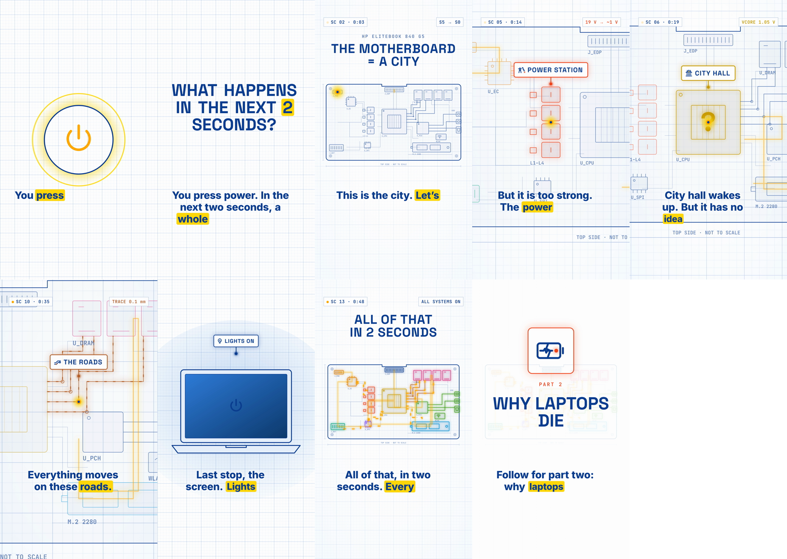

# Motherboard: "Press power. A city wakes up."

A 72-second, 9:16 explainer video. One electron travels from the power button to the screen of an
HP EliteBook 840 G5, and every part of the board is a building in a city. It's built with
[Remotion](https://www.remotion.dev) and renders natively at **2160 × 3840 (4K)**.



**New here? Follow [SETUP.md](SETUP.md)** for step-by-step setup on Windows, including changing the voice, music and photos.

## Setup (once)

You need Node.js 20 or newer. Remotion downloads its own Chrome and ffmpeg.

```bash
npm install
```

## Preview

```bash
npm run studio
```

This opens the editor in your browser, where you can scrub through the timeline instantly.

## Render

| Command | Output | Use |
|---|---|---|
| `npm run render:draft` | 1080p MP4 | Quick check, a few minutes |
| `npm run render:4k` | 4K MP4, CRF 10, lossless PNG frames | Upload master |
| `npm run render:prores` | 4K ProRes 4444 MOV, very large | If you'll edit or grade it afterwards |

Output goes to `out/`. On an i7-8650U, the 4K render takes roughly 25–50 minutes. Plug in the
charger and set Windows to **Best performance** first.

## Add your photos and audio

Everything is in `src/config.ts`.

1. Put photos in `public/photos/` and set their paths, e.g. `hall: 'photos/cpu.jpg'`. Each photo
   gets the blueprint grade automatically, with the drawn board over it.
2. Put the voiceover and music in `public/audio/` and set `voiceover` and `music`.

A placeholder synth track, `public/audio/placeholder-synth.wav`, is already wired in. It's a low pulse
that builds, a click on the button press, a blip at each stop, a riser, and a "power on" hit when the laptop
screen lights up. It's generated by `tools/make_placeholder_music.py`, so you can
change it and regenerate it with `python3 tools/make_placeholder_music.py` (needs numpy).

The voiceover, `public/audio/voiceover.wav`, is read by Kokoro, an offline neural text-to-speech
model, in its calm, warm `af_heart` voice, one line per scene. Nothing is sped up: the script sets
each scene's length from its line and writes the timings to `src/timeline.json`. To try another
voice, see step 6 in [SETUP.md](SETUP.md).

## Where things live

| File | What's in it |
|---|---|
| `src/timeline.json` | Scene timings, generated from the voiceover |
| `src/data.ts` | Caption lines, colors, zoom per stop |
| `src/Board.tsx` | The blueprint drawing of the board |
| `src/icons.tsx` | The 10 custom SVG building icons, plus the power and dead-battery icons |
| `src/CityWakes.tsx` | Camera, electron, pins, captions and the special scenes |
